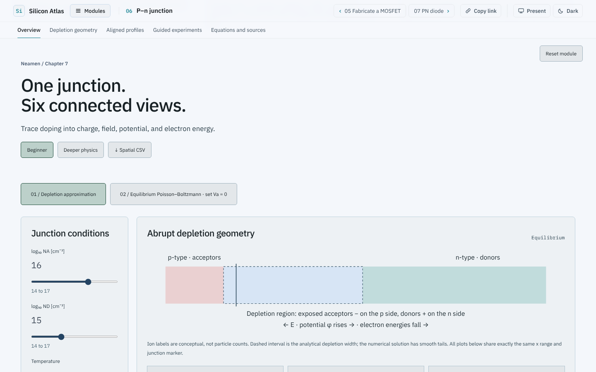

# Silicon Atlas

[](https://github.com/Sean-KSH/silicon-atlas/actions/workflows/ci.yml)
[](LICENSE)

**Live demo: [sean-ksh.github.io/silicon-atlas](https://sean-ksh.github.io/silicon-atlas/)**

Silicon Atlas is a set of ten interactive labs for introductory solid-state devices and
electronic/photonic devices courses. Each lab takes a model from the course and lets a student
change it and watch what happens. Change a doping level, a bias, a wavelength or a process step,
and the physical picture, the equations and the plots all update from the same calculation. The
lab then explains in words what changed and why.

It runs in a web browser with no accounts or installation, and it is meant to support class
demonstrations, independent exploration and guided assignments. Open the
[live demo](https://sean-ksh.github.io/silicon-atlas/) to try it.


<details>
<summary>Light theme</summary>



</details>

## Where the project stands

Version 0.9, pre-release, November 2026.

- All ten modules are built and working, with a shared course guide, navigation, learning goals and
  self-check questions.
- 89 automated test groups check the physics code against exact solutions, conservation laws,
  independent calculations and Neamen's worked examples. All pass. The latest record is in
  [`docs/validation-run.md`](docs/validation-run.md).
- No module has been compared with measured data yet. The tests show that the code solves its
  chosen equations correctly, not that those equations match a real device beyond what the
  textbook model already claims.
- Not done yet: a full literature review, a model card for each model, and feedback from
  instructors.

This is an independent student project. It is not an official product of, or endorsed by,
Princeton University or any course.

## The ten modules

| # | Module | What a student explores | Main model | Reading |
| --- | --- | --- | --- | --- |
| 01 | Silica to wafer | Purification, Czochralski growth, how impurities spread along an ingot | Scheil equation; simple heat balance | Neamen §§1.6–1.7 |
| 02 | Atoms to bands | The silicon lattice, quantum wells, tunneling, how bands form, effective mass | Infinite well; rectangular barrier; 1D tight-binding chain (illustrative) | Neamen Ch. 1–3 |
| 03 | Equilibrium carriers | Density of states, Fermi–Dirac occupation, doping, compensation, freeze-out | Charge neutrality with Boltzmann or Fermi–Dirac statistics | Neamen Ch. 4 |
| 04 | Transport & lifetime | Drift, diffusion, generation, recombination, diffusion length | 1D continuity equation, finite-volume solver | Neamen Ch. 5–6 |
| 05 | Fabricate a MOSFET | The course's four-mask metal-gate nMOS process, step by step | Deal–Grove oxidation; diffusion profiles; lithography threshold | Course process notes |
| 06 | P–n junction | Charge, field, potential and band bending; bias and capacitance | Depletion approximation; equilibrium Poisson–Boltzmann solver | Neamen Ch. 7 |
| 07 | PN diode | Carrier injection, the ideal I–V curve, stored charge, switching | Shockley diode with finite neutral regions; charge control | Neamen Ch. 8 |
| 08 | Gate control | MOS capacitor and C–V, then the long-channel MOSFET | 1D Poisson solution; gradual-channel model | Neamen Ch. 10–11 |
| 09 | Photonic devices | Absorption, photodiodes, solar cells, LEDs, laser threshold | Beer–Lambert generation; illuminated diode; rate equations | Neamen Ch. 14 |
| 10 | Measurement bench | Sheet resistance, transistor extraction, inverters, a ring oscillator, optical tests | Square-law transistor circuits; instrument error models | Lab manual; Neamen Ch. 11 |

The modules connect to each other. The fabrication result in module 05 can be imported into the
MOSFET in module 08, and every module draws its silicon and GaAs values from one shared parameter
file ([`src/materials.ts`](src/materials.ts), Neamen Appendix B), so they never disagree.

## How it is meant to be used

**Students** open the course guide, pick a module, and follow the same pattern in each one:

1. Read the learning goals, time estimate, reading and prerequisites at the top.
2. Change one control and watch the linked diagrams and plots respond.
3. Read the "What changed and why?" panel, which also says what was held fixed.
4. Try the guided experiments, which ask for a prediction before showing the answer.
5. Open "Deeper physics" and the equations and sources panels when ready for the full model.
6. Answer the "Check your understanding" questions at the end, then move to the next module.

The course guide suggests two orders: one for a solid-state device physics course (about 3 hours)
and one for an electronic and photonic devices course that starts from fabrication and ends at the
measurement bench (about 3.5 hours).

**Instructors** will find a ten-minute demonstration for every module on the course guide, built
from presets that restore the same tested settings every time. These tools in the top bar help in
class:

| Tool | What it does |
| --- | --- |
| Present | Enlarges everything by a quarter so labels are readable from the back of a room. |
| Light / Dark | Switches theme. Light works better on projectors in a lit room. Printing always uses light. |
| Copy link | Copies a link that reopens the module with its exact current settings, for slides and assignments. |
| `[` and `]` | Keyboard keys for the previous and next module while presenting. |
| Print | Prints a module with its goals and self-check questions (answers left out) as a handout. |
| CSV buttons | Most plots export their data for use in homework. |

## How the physics is handled

The aim is the simplest model that teaches each idea correctly over a stated range, not the most
complete model. In practice that means:

- **Assumptions are visible.** Every module states its model, its assumptions and the range of
  inputs it supports. Full details are in [`docs/limitations.md`](docs/limitations.md).
- **Out-of-range inputs are not drawn as if they were valid.** When a control leaves the range
  where a model holds (high injection, very high fields, a short channel), the module warns or
  withholds the result instead of showing a confident wrong answer. Solver failures are reported,
  not hidden.
- **Calculation and illustration are kept apart.** Animated carriers, schematic equipment and toy
  band structures are labeled as illustrations. Exaggerated scales are labeled.
- **Equilibrium and bias are kept apart.** For example, the junction module's numerical solver runs
  only at equilibrium, and the Fermi level line is removed under bias.
- **One set of material parameters.** All modules use Neamen Table B.4 values. One known teaching
  choice: silicon's intrinsic concentration is computed from those values (about 6.7×10⁹ cm⁻³ at
  300 K) rather than the 1.5×10¹⁰ cm⁻³ used in Neamen's examples or the roughly 9.65×10⁹ cm⁻³ in
  current research literature. The modules say so where it matters.
- **Known simplifications.** The band gap and mobilities are held at their 300 K values, and
  mobility does not depend on doping. Both are noted in the modules and listed as possible
  improvements in [`docs/decisions.md`](docs/decisions.md).

The physics code is separate from the interface (`src/*.ts`, no React), so every model can be run
and tested on its own.

## Run it

Requires Node 20 or newer.

**On a Mac:** double-click `scripts/start-mac.command`. It installs what is needed, starts the app
and opens it in your browser. Close the Terminal window to stop it.

**Any system:**

```sh
pnpm install
pnpm dev          # opens at http://127.0.0.1:5173
```

| Command | What it does |
| --- | --- |
| `pnpm test` | Runs all physics and integration tests |
| `pnpm validate` | Runs the tests module by module and writes [`docs/validation-run.md`](docs/validation-run.md) with the commit it was run on |
| `pnpm build` | Type-checks and builds a static site into `dist/` |
| `pnpm preview` | Serves the built site locally |
| `pnpm format` | Formats the source code |

The built site is plain static files with relative paths, so it can be hosted anywhere. The live
demo is built and published by GitHub Actions on every push to `main`
([`.github/workflows/pages.yml`](.github/workflows/pages.yml)); the same tests and build also run as
checks on every push and pull request. Each module has its own address, such as `#junction`, and a copied link adds the
settings after it, for example `#junction?na=1e23&voltage=-0.1` (values in SI units).

## Project layout

```
src/
  materials.ts        shared constants and Si, GaAs, SiO2 parameters (Neamen Appendix B)
  <model>.ts          physics for each module, independent of the interface, in SI units
  <model>.test.ts     tests for each model
  <Module>Lab.tsx     each module's interface (Wafer.tsx is module 01)
  modules.ts          the list of ten modules, their order and addresses
  lessons.ts          learning goals, reading, demos and self-check questions
  Shell.tsx, Home.tsx the top bar, course guide and the panels around each module
  urlState.ts         keeps module settings in the link
  theme-colors.css    every colour as a variable, with dark and light values
scripts/              Mac launcher, validation report, light-theme colour generator
.github/              checks and live-demo workflows, issue forms
docs/                 audit, validation, limitations, decisions, model cards, literature review
paper/                bibliography for a future technical report
output/screenshots/   current screenshots of every module
```

## Documentation

| Document | What it covers |
| --- | --- |
| [`docs/audit.md`](docs/audit.md) | What is implemented, checked, inconsistent or still missing |
| [`docs/validation.md`](docs/validation.md) | What each automated check establishes, and what it does not |
| [`docs/validation-run.md`](docs/validation-run.md) | The latest test record, tied to a commit |
| [`docs/limitations.md`](docs/limitations.md) | Supported ranges and what each module leaves out |
| [`docs/decisions.md`](docs/decisions.md) | Model, parameter and design decisions, including open ones |
| [`docs/literature-review.md`](docs/literature-review.md) | Primary sources and how far each has been checked |
| [`docs/models/`](docs/models/) | Model cards (shared materials so far) |
| [`docs/implementation-notes.md`](docs/implementation-notes.md) | Detailed notes from building each module |
| [`context.md`](context.md) | The project's goals and quality expectations |

## Next steps

1. Get feedback from instructors on accuracy, course fit and usability.
2. Finish the literature review and write a model card for each model.
3. Decide the open physics questions in `docs/decisions.md` (which intrinsic concentration to
   teach with; temperature-dependent band gap and doping-dependent mobility).
4. Add instructor materials and a technical report.

Found something wrong? Please [open an issue](https://github.com/Sean-KSH/silicon-atlas/issues/new/choose).
The "Physics or content issue" form asks for the module, what looks wrong and a reference. See
[`CONTRIBUTING.md`](CONTRIBUTING.md) for how the code is organized and what a model change needs.

## Sources

The main physics reference is D. A. Neamen, *Semiconductor Physics and Devices: Basic Principles*,
4th edition. Course lecture notes and the lab measurement manual shaped the scope and the
fabrication sequence. Modules cite chapter, section and page for the equations and parameter tables
they use. Textbooks, slides and manuals are not included in this repository. All explanations and
graphics are original.

## License

[MIT](LICENSE). You may use, adapt and share Silicon Atlas, including in courses, with credit.
Bundled fonts (IBM Plex) are under the SIL Open Font License; other third-party licenses are listed
in [`docs/third-party-licenses.md`](docs/third-party-licenses.md).

## Citing

See [`CITATION.cff`](CITATION.cff).
