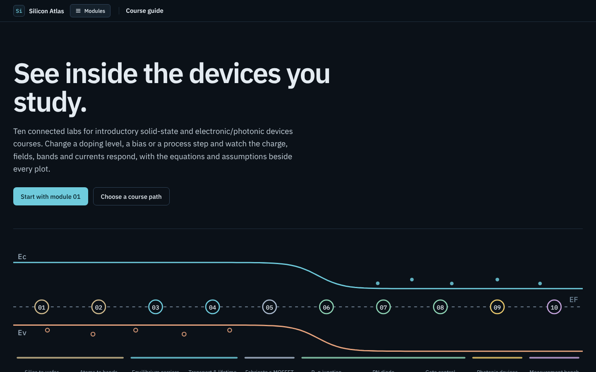

# Silicon Atlas

Interactive simulations for introductory semiconductor materials and devices courses. Each module
turns a textbook model into something a student can change and watch respond: the physical picture,
the governing equations and the resulting plots are driven by one model state.

The platform is an educational tool, not a TCAD or process-prediction package. Every module uses the
simplest model that teaches its concept within a stated operating range, shows its assumptions, and
refuses or flags inputs outside that range instead of drawing a confident wrong answer.

> Status: pre-release (0.9.0). All ten modules are implemented and pass their automated checks, but
> the literature review, per-model documentation, instructor materials, license and deployment are
> still in progress. See [`docs/audit.md`](docs/audit.md) for the current state.



## Modules

| # | Module | What a student explores | Main model(s) |
| --- | --- | --- | --- |
| 01 | Silica to wafer | Purification route, Czochralski growth, impurity segregation along an ingot | Scheil equation; lumped interface heat balance |
| 02 | Atoms to bands | Diamond-cubic lattice and Miller planes, particle in a well, tunneling, band formation, effective mass | Infinite well; rectangular-barrier transmission; 1D tight-binding chain (illustrative) |
| 03 | Equilibrium carriers | Density of states, Fermi–Dirac occupation, doping, compensation, ionization, freeze-out | Charge neutrality with Boltzmann or Fermi–Dirac statistics |
| 04 | Transport & lifetime | Drift, diffusion, generation, recombination, diffusion length | 1D minority-carrier continuity equation, finite-volume solver |
| 05 | Fabricate a MOSFET | The course's four-mask metal-gate nMOS flow in linked top and cross-section views | Deal–Grove oxidation; constant-D diffusion profiles; thresholded Gaussian lithography |
| 06 | P–n junction | Charge, field, potential and band bending; bias and capacitance | Depletion approximation; equilibrium Poisson–Boltzmann solver |
| 07 | PN diode | Minority-carrier injection, ideal I–V, stored charge, switching | Shockley diode with finite neutral regions; charge control |
| 08 | Gate control | MOS capacitor C–V, threshold, long-channel MOSFET I–V | 1D Poisson first integral; gradual-channel charge-sheet model |
| 09 | Photonic devices | Absorption, photodiodes, solar cells, LEDs, laser threshold | Beer–Lambert generation; illuminated ideal diode; rate equations |
| 10 | Measurement bench | Sheet resistance, FET parameter extraction, inverters, ring oscillator, optical measurements | Square-law FET circuits solved by KCL and RK4; instrument error models |

Material parameters are shared by all modules from one sourced file, [`src/materials.ts`](src/materials.ts).

## Run it

Requires Node 20 or newer and [pnpm](https://pnpm.io).

```sh
pnpm install
pnpm dev          # http://127.0.0.1:5173
```

The app opens on a course guide: a map of the ten modules, two suggested course paths, how a
lab works and ten-minute demonstrations for instructors. Each module has its own URL hash, for
example `http://127.0.0.1:5173/#junction`, and is framed by the same app bar (modules menu,
previous/next, and "On this page" shortcuts), a lesson intro (goals, reading, prerequisites) and
self-check questions with hidden answers.

| Command | What it does |
| --- | --- |
| `pnpm test` | Runs every physics and integration test group |
| `pnpm validate` | Runs the tests per module and writes [`docs/validation-run.md`](docs/validation-run.md) with the commit hash |
| `pnpm typecheck` | TypeScript, strict mode |
| `pnpm build` | Typecheck and production build into `dist/` (static files, no server needed) |
| `pnpm format` | Prettier formatting for `src/` |

The build output in `dist/` is a static site with relative paths, so it can be served from any
static host or sub-path, including GitHub Pages. No deployment is configured yet. To try the
production build locally, run `pnpm build && pnpm preview`.

## Project layout

```
src/
  materials.ts        shared constants and Si/GaAs/SiO2 reference parameters
  modules.ts          the ten-module registry (order, URL, stage, summary)
  lessons.ts          learning-guide text: goals, reading, section shortcuts, demos, questions
  main.tsx            app entry; loads each module on demand
  Shell.tsx           app bar, modules menu, section shortcuts, lesson intro and outro
  Home.tsx            course guide and course map
  shell.css           shared design tokens and the frame around every module
  <model>.ts          physics kernels, independent of React (SI units internally)
  <model>.test.ts     validation tests for each kernel
  <Module>Lab.tsx     module interfaces (Wafer.tsx for module 01)
  *.css               module styles
scripts/              validation report generator
docs/                 audit, validation, decisions, limitations, model cards, literature review
paper/                bibliography for the technical report (manuscript not started)
output/               screenshots of each module and an example exported figure
```

Physics kernels never import React, so every model can be called and tested on its own.

## Documentation

- [`docs/audit.md`](docs/audit.md): what is implemented, validated, inconsistent or missing
- [`docs/validation.md`](docs/validation.md): validation matrix, and what it does and does not establish
- [`docs/validation-run.md`](docs/validation-run.md): latest generated test record
- [`docs/limitations.md`](docs/limitations.md): supported ranges and known limits per module
- [`docs/decisions.md`](docs/decisions.md): model, parameter and architecture decisions
- [`docs/models/`](docs/models/): model cards (materials so far)
- [`docs/literature-review.md`](docs/literature-review.md): primary sources and their verification status
- [`docs/implementation-notes.md`](docs/implementation-notes.md): detailed notes from the initial build
- [`context.md`](context.md): project goals and quality expectations

## Sources and scope

The principal reference is D. A. Neamen, *Semiconductor Physics and Devices: Basic Principles*,
4th ed. Modules cite chapter, section and page for the equations and parameter tables they use, and
label every chosen teaching parameter as such. Course lecture slides and the lab manual informed
scope and the fabrication sequence. Textbooks, lecture slides and lab manuals are **not**
redistributed in this repository; `.gitignore` excludes them.

Explanations and graphics are original. This is an independent student project and is not an
official product of, or endorsed by, Princeton University or any course.

## License

Not yet chosen. Until a license file is added, all rights are reserved by the author.

## Citing

See [`CITATION.cff`](CITATION.cff).
